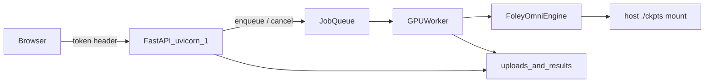

# Foley-Omni Preview Webapp + Docker

## Decisions locked

- **Auth**: lightweight shared tokens — `ACCESS_TOKEN` (buyers) + `ADMIN_TOKEN` (ops). No accounts/SSO.
- **Checkpoints**: mount host `./ckpts` into the container (never bake/download in image).
- **GPU**: one process, one inference worker (concurrency = 1).
- **UI**: single static page (no React). Buyers paste token once; stored in `localStorage`.

## Architecture



## Auth model

| Token | Env | Capabilities |
|-------|-----|----------------|
| Buyer | `ACCESS_TOKEN` | Use UI/API, submit jobs, cancel **own** queued jobs, download **own** results |
| Admin | `ADMIN_TOKEN` | Everything buyer can do + `POST /api/admin/queue/clear` (queued only; running stays) |

- Clients send `X-API-Key: <token>` (page stores it after a gate screen).
- Jobs store `owner_token_hash` (sha256 of the key used) so cancel/download is scoped without storing raw tokens in JSON.
- Missing/invalid key → `401`. Wrong owner on cancel/result → `403`.

## API

- `GET /api/health` — public enough for Docker healthcheck (no secrets); returns `model_loaded`, `gpu_busy`, `queue_depth`.
- `POST /api/jobs` — multipart: `video`, optional `words` / `audio_caption` / `music`, `seed`, `sample_steps`. Builds `resp` tagged prompt server-side. Returns `202 { job_id, status, position }`. Reject if queue full (`MAX_QUEUE_SIZE`, default 10) → `429`.
- `GET /api/jobs/{job_id}` — status, position (if queued), error, progress text.
- `DELETE /api/jobs/{job_id}` — cancel if `queued` and owner matches; if `running` → `409` (cannot abort mid-CUDA safely in v1).
- `GET /api/jobs/{job_id}/result` — stream `result.mp4` when `done`, owner-scoped.
- `POST /api/admin/queue/clear` — admin only; marks all `queued` jobs `cancelled`; does not touch `running`.

## App layout (new)

```text
app/
  __init__.py
  main.py          # FastAPI lifespan: load engine, start worker
  auth.py          # token verify + owner hash
  schemas.py
  jobs.py          # Job dataclass + JobStore (memory + disk JSON)
  queue_worker.py  # asyncio.Queue + single thread/to_thread consumer
  inference_service.py  # wrap FoleyOmniEngine + generate_audio_for_video
  config.py        # env + OmegaConf load of inference_v2st.yaml defaults
static/
  index.html       # token gate, upload form, queue list, cancel, admin clear
  app.js
  styles.css
storage/           # runtime only (volume)
  uploads/{job_id}/
  results/{job_id}/
  jobs/{job_id}.json
```

Reuse inference from [`inference_v2st.py`](inference_v2st.py) (`generate_audio_for_video`, feature load, mux) and [`foley_omni/fusion_engine.py`](foley_omni/fusion_engine.py) — extract callable service helpers rather than subprocessing the CLI. Force `sp_size=1`, no NCCL.

**Worker**: one consumer; inference runs in `asyncio.to_thread` so HTTP stays responsive. Global engine singleton; only the worker touches CUDA.

**Cancel semantics**: remove from in-memory queue if still waiting; update job JSON to `cancelled`. Running job is left alone (document in UI).

## Webpage UX

1. Token gate (buyer or admin token).
2. Form: video upload, Words / Audio caption / Music, seed/steps.
3. After submit: show job id, queue position, status poll (~2s).
4. **Cancel** button while `queued`.
5. If admin token detected (probe via a tiny `GET /api/me` returning `{ role: buyer|admin }`): show **Clear queue** button.
6. On `done`: inline `<video>` + download.

Validate video duration ≤ 10s server-side (reuse duration helper); reject short sync-unsafe clips with clear error.

## Docker (professional, GPU)

New files:

- [`Dockerfile`](Dockerfile) — NVIDIA CUDA 12.4 + Python 3.10 base matching README; install torch cu124, `requirements.txt`, flash-attn, app deps (`fastapi`, `uvicorn[standard]`, `python-multipart`). Do **not** copy `ckpts/`. Copy app code only.
- [`.dockerignore`](.dockerignore) — `ckpts/`, `outputs/`, `storage/`, `.git`, examples videos if huge, `__pycache__`.
- [`docker-compose.yml`](docker-compose.yml):
  - `gpus: all` / device reservation
  - volumes: `./ckpts:/app/ckpts:ro`, `./storage:/app/storage`
  - env: `ACCESS_TOKEN`, `ADMIN_TOKEN`, `CKPT_DIR=/app/ckpts`, `MAX_QUEUE_SIZE`, `CPU_OFFLOAD` optional
  - `uvicorn app.main:app --host 0.0.0.0 --port 8000 --workers 1`
  - healthcheck → `GET /api/health`
- [`.env.example`](.env.example) — token placeholders, no secrets.
- [`DEPLOY.md`](DEPLOY.md) — prerequisites (NVIDIA Container Toolkit), download ckpts via existing [`scripts/download_release_ckpts.sh`](scripts/download_release_ckpts.sh), `docker compose up --build`, how to give buyers the access token, admin clear-queue, ports, VRAM notes (`cpu_offload`).

Optional thin [`requirements-web.txt`](requirements-web.txt) for FastAPI stack so core ML requirements stay unchanged.

## Config wiring

App loads defaults from [`inference_v2st.yaml`](inference_v2st.yaml) but overrides:

- `ckpt_dir` / `model_checkpoint` from env paths inside container
- `output_dir` → per-job under `storage/results/{job_id}`
- `sp_size: 1`, `json_file` unused

## Out of scope (v1)

- Aborting an in-flight CUDA job
- Redis/Celery, multi-GPU, baking weights
- Full user accounts / rate limits beyond queue cap
